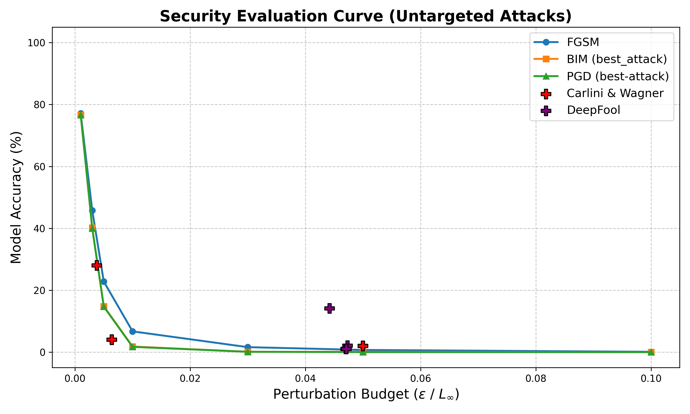
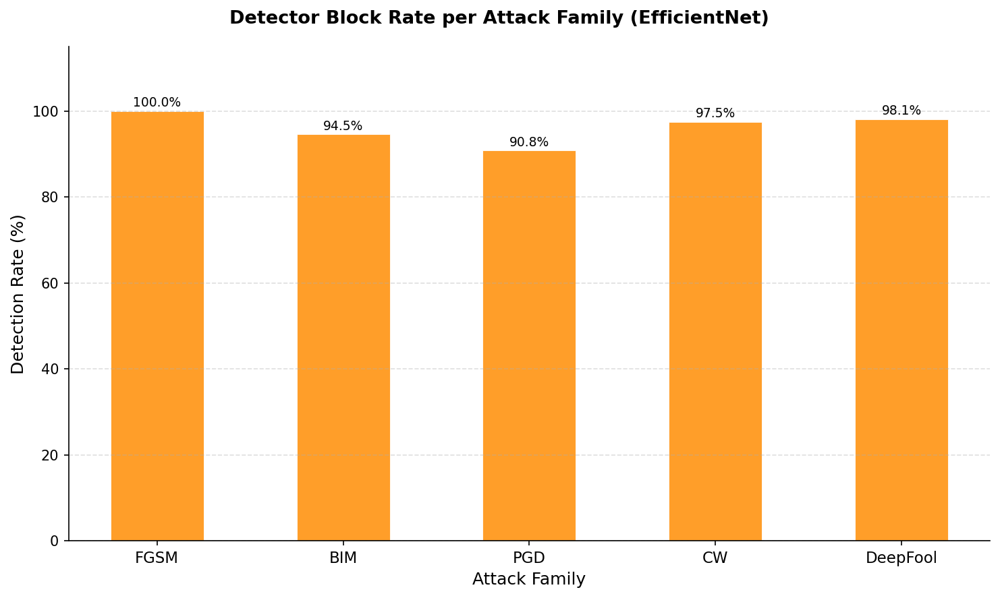

# Adversarial Attacks and Defences for Face Recognition

Security evaluation of a deep face recognition system under evasion attacks, carried out with the
[Adversarial Robustness Toolbox](https://github.com/Trusted-AI/adversarial-robustness-toolbox) (ART).
The project measures how much white-box adversarial perturbations degrade identification, whether they
transfer to a second, independently trained network, and how far two defences (an adversarial example
detector and JPEG compression) mitigate them, including against an attacker who knows the detector.

| | Model | Role |
|---|---|---|
| **NN1** | Inception-ResNet-v1 (FaceNet), trained on VGGFace2 ([facenet-pytorch](https://github.com/timesler/facenet-pytorch)) | white-box target of the attacks |
| **NN2** | ResNet-50, MS1M pre-training + VGGFace2 fine-tuning ([Cao et al., 2018](https://arxiv.org/abs/1710.08092)) | transferability target |
| **Detector** | EfficientNet-B0 (and MobileNetV3-Large) binary classifier, genuine vs adversarial | defence |

Both networks classify among the 8631 VGGFace2 training identities. Test set: 100 identities × 10 images
(1000 images) sampled from VGGFace2 with a fixed seed; the slow per-sample attacks (CW, DeepFool) use one
image per identity.

## Threat model

- **Goal:** evasion, either *error-generic* (any wrong identity) or *error-specific* (a chosen target identity:
  a fixed one, class 2026, or the least likely class for each image).
- **Knowledge:** white-box on NN1 (gradients available); black-box on NN2 (transfer from NN1).
- **Capability:** L∞-bounded perturbation on the 160×160 input in [0, 1], ε ≤ 0.1 (10% of the pixel range).
  CW and DeepFool are not budget-constrained by design: examples above the budget are counted as failed
  attacks (the clean image is used).

Attacks: FGSM, BIM, PGD (with 0–5 random restarts), Carlini & Wagner L∞, DeepFool. Results are reported as
Security Evaluation Curves: accuracy (error-generic) or attack success rate (error-specific) versus ε.

## Results

### White-box attacks on NN1

Clean accuracy of NN1: **85.1%** (NN2: 95.5%).

<p align="center"></p>

| NN1 accuracy (%) | ε = 0.003 | ε = 0.01 | ε = 0.03 | ε = 0.1 |
|---|---|---|---|---|
| FGSM | 45.8 | 6.7 | 1.6 | 0.1 |
| BIM, 20 iterations | 40.2 | 1.8 | 0.1 | 0.1 |
| PGD, 40 iterations, 5 restarts | — | 3.7 | 0.2 | 0.1 |

| Error-specific (fixed target), ASR (%) | ε = 0.01 | ε = 0.03 | ε = 0.1 |
|---|---|---|---|
| FGSM | 1.7 | 8.0 | 4.9 |
| BIM / PGD, 20 iterations | 20.6 | 98.5 | 100.0 |

CW L∞ reaches 4% accuracy with a mean L∞ of 0.006; DeepFool reaches 1% with a mean of 0.047.
A perturbation of ε = 0.01 (≈ 2.5 grey levels) is enough to drop identification below 7% with every
attack, and iterative attacks reach any chosen identity with ε = 0.03. Single-step FGSM does not work as a
targeted attack: its success rate *decreases* from ε = 0.03 to 0.1, because one large step overshoots
the target region.

### Transferability to NN2

Adversarial examples crafted on NN1 transfer well when the goal is only to cause an error, but not
when a specific identity is targeted:

| | ε = 0.01 | ε = 0.03 | ε = 0.1 |
|---|---|---|---|
| NN2 accuracy, FGSM | 66.6% | 20.1% | 0.7% |
| NN2 accuracy, PGD (20 it.) | 66.2% | 21.7% | 3.9% |
| NN2 target hit rate, PGD fixed target (20 it.) | 0.0% | 0.5% | 3.0% |

Stronger white-box optimisation transfers *slightly worse* at ε = 0.1 (FGSM 0.7% vs PGD-20 3.9% NN2 accuracy):
more iterations overfit the perturbation to NN1.

### Defences

**Adversarial detector.** A binary classifier trained on 6000 adversarial examples from 40 attack configurations
(weak to strong, all five families) and as many clean images; CW and DeepFool examples, the hardest to detect,
are oversampled ×3 during training. The split is **identity-disjoint** (70/20/10
subjects), so the test identities are never seen in training; the threshold (0.11) is set at the Equal Error
Rate on the validation set.

| Test set (10 unseen identities, 1160 images) | EfficientNet-B0 |
|---|---|
| Accuracy / F1 / AUROC | 95.0% / 0.949 / 0.991 |
| Adversarial block rate | 96.1% |
| Genuine images rejected (FPR) | 6.0% |
| System accuracy, detector + NN1 (blocked attack = correct) | 87.8% |

<p align="center"></p>

**JPEG compression** (input transformation before NN1) recovers little: at quality 50 the accuracy on adversarial
images goes from 14.3% to 24.6% with no loss on clean images; at quality 10 it reaches 37.9% but clean accuracy
drops from 85.2% to 72.5%.

### Adaptive attack against the detector

The detector results above hold only for an attacker who ignores the defence. To test this, PGD was rerun on the
100 clean images of the 10 test identities with an objective that also includes the detector
(`advfr/adaptive.py`, [Carlini & Wagner, 2017](https://arxiv.org/abs/1705.07263);
[Tramer et al., 2020](https://arxiv.org/abs/2002.08347)):

maximise CE(NN1(x), y) + λ · log(1 − D(x)),  ‖x − x₀‖∞ ≤ ε (20 iterations; λ = 0 is standard PGD)

| 100 clean images, 10 unseen identities | Detected | NN1 accuracy | **System bypassed** (undetected and misidentified) |
|---|---|---|---|
| Clean | 3% | 87% | — |
| PGD, ε = 0.005 (λ = 0 → λ = 1) | 39% → **0%** | 21% → 21% | 51% → **79%** |
| PGD, ε = 0.01 (λ = 0 → λ = 1) | 96% → **0%** | 0% → 0% | 4% → **100%** |
| PGD, ε = 0.03 (λ = 0 → λ = 1) | 100% → **0%** | 0% → 0% | 0% → **100%** |
| PGD, ε = 0.1 (λ = 0 → λ = 1) | 100% → **0%** | 0% → 0% | 0% → **100%** |

Adversarial images are quantised to 8 bits before evaluation, as they would be when stored or sent.

With λ = 0 the detector catches almost every example from ε = 0.01, as in the test set. Once the attacker adds the
detector to the loss, every image bypasses the full system (detector + NN1) at ε = 0.01, about 2.5 grey levels: the detector learned to recognise the
perturbations of non-adaptive attacks, not adversarial inputs as such. It raises the cost of an attack only for
an attacker unaware of it.

## Notes on the evaluation

Points found while reorganising the code, documented so that the numbers are read correctly:

- **CW error-specific results are invalid (ART bug).** In ART ≤ 1.20.1, `CarliniLInfMethod` checks the success of
  a targeted attack with `!=` instead of `==` against the target, so it keeps the candidates that *miss* the
  target. This is why CW targeted shows 0% ASR at every configuration. `advfr.attacks.CarliniLInfMethodFixed`
  corrects the check (identical to ART for untargeted attacks); the targeted CW experiments were not rerun. Reported
  upstream with a fix in [Trusted-AI/adversarial-robustness-toolbox#2878](https://github.com/Trusted-AI/adversarial-robustness-toolbox/pull/2878).
- **NN2 transferability reference.** Adversarial examples are stored at 160×160 (NN1 input) and upsampled for NN2.
  Clean images through the same pipeline give 89.0% on NN2, not 95.5%: the reference for the transfer results is
  89.0%, and about 6.5 points of the NN2 drop come from the resolution, not from the attack
  (`advfr.transferability.nn2_reference_accuracy`).
- **No format shortcut in the detector.** Clean images are JPEG at native resolution, adversarial images 160×160
  PNG. Clean test images re-saved as 160×160 PNG are flagged at the same rate as the originals (3.0%), so the
  detector does not separate the classes by file format.
- **DeepFool and CW denominators.** Examples over the budget count as failed attacks (fixed denominator of 100);
  the original DeepFool numbers excluded them, so accuracies such as 1.04% (1/96) are slightly optimistic for the
  attacker.
- The refactored code was checked against the original runs: NN1 and NN2 clean accuracy match exactly, FGSM differs
  by one image in 1000 (ε = 0.005: 22.9% vs 22.8%; ε = 0.01: 6.8% vs 6.7%; CPU vs the original GPU run), and the
  identity-disjoint split reproduces the original subjects in every split.

## Repository structure

```
advfr/
  config.py           paths and experiment constants
  data.py             test-set construction from VGGFace2, label mapping, image I/O
  models.py           NN1, NN2, pre-processing, ART wrapper
  nets/               ResNet-50 definition for NN2 (cydonia, MIT)
  attacks.py          attack factory, evaluation with L-inf budget, fixed CW L-inf
  transferability.py  evaluation of the stored examples on NN2
  detector.py         detector model, dataset, identity-disjoint split, training, EER
  defenses.py         detector + NN1/NN2 system evaluation, JPEG compression
  adaptive.py         adaptive PGD against detector + NN1
  plots.py            security evaluation curves
scripts/              command-line entry points (one per experiment)
notebooks/            run_on_colab.ipynb: full pipeline on a Colab GPU
dataset_splits/       identity-disjoint detector splits (file lists)
results/              CSVs and plots of the experiments
```

## Usage

```bash
pip install -r requirements.txt
pip install --no-deps facenet-pytorch
```

`facenet-pytorch` (NN1) is installed without its dependencies because it pins old versions of PyTorch and Pillow
that do not install on recent Python versions; its runtime dependencies are in `requirements.txt`.

Data and weights are not included (VGGFace2 licence, file size):

- `data/`: built from the VGGFace2 metadata and training archive with
  `python scripts/prepare_data.py --meta identity_meta.csv --archive vggface2_train.tar.gz`.
- `weights/resnet50_ft_weight.pkl`: NN2 weights, from the
  [VGGFace2 PyTorch port by cydonia](https://github.com/cydonia999/VGGFace2-pytorch).
- `weights/detector_*.pth`: detector weights, from the [Releases](../../releases) page.
- NN1 weights and the VGGFace2 label list are downloaded automatically.

```bash
python scripts/baseline.py
python scripts/run_attacks.py pgd --max-iter 10 --random-init 1 --targeted fixed --save
python scripts/transferability.py PGD_Targeted_Fixed_nri1_iter10 --target 2026
python scripts/train_detector.py --backbone efficientnet
python scripts/evaluate_defenses.py --backbone efficientnet
python scripts/adaptive_attack.py --eps 0.005 0.01 0.03 0.1 --lams 0 1
```

## Authors

Group project (Group 15), MSc in Computer Engineering, University of Salerno, course *AI for Cybersecurity*:

- Raffaele Rosanova ([@RaffaeleRosanova01](https://github.com/RaffaeleRosanova01)), repository maintainer
- Christian Rosa
- Simone Savino Candido
- Salvatore Francesco Tartaglione

## License

MIT, see [LICENSE](LICENSE). The ResNet-50 definition in `advfr/nets/` is from cydonia/VGGFace2-pytorch (MIT).
VGGFace2 images are not redistributed.
